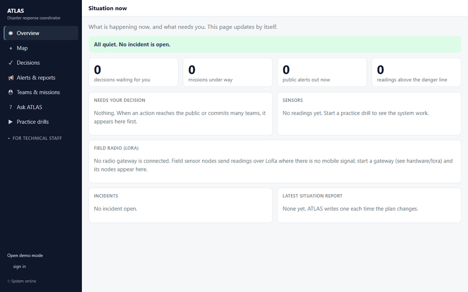
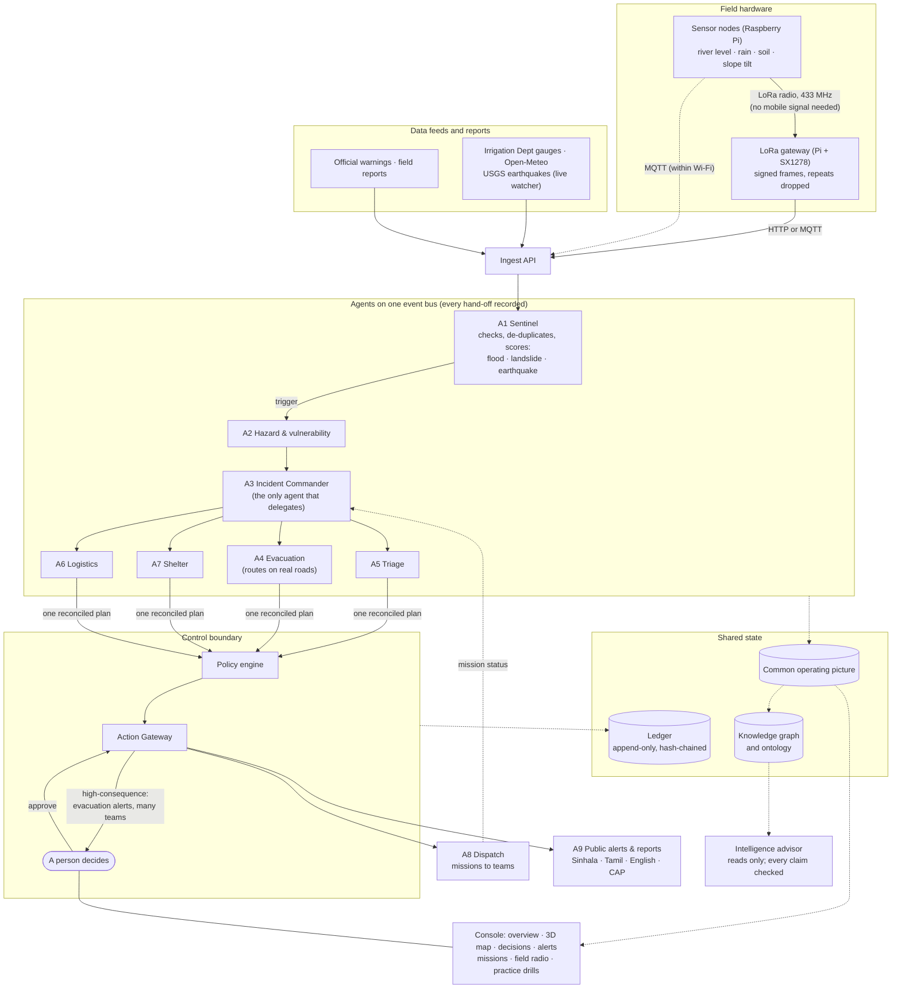

# ATLAS — Autonomous Triage, Logical Agentic System

> **Team ClapTac** · General Sir John Kotelawala Defence University
> CodeSplash '26 Agentic AI Phase · Theme 3: AI Disaster Response Coordinator

ATLAS helps a disaster-management office run the first hours of a flood, landslide or earthquake in
Sri Lanka. It watches river gauges, rainfall, soil moisture, slope sensors, earthquake reports and
field reports. When something significant
happens it opens an incident, works out who is at risk, plans evacuation routes and shelter places,
assigns rescue teams and vehicles, and drafts public alerts in Sinhala, Tamil and English.

It acts on its own for routine work and **asks a person before anything reaches the public or
commits scarce teams**. Every decision, by an agent or a person, is kept in a record that cannot be
altered.

It runs on a laptop with no internet, no hardware and no AI key. Real recorded disasters (Cyclone
Ditwah at Ratnapura, November 2025) can be replayed as practice drills.

---



## Run it with Docker (recommended)

**Prerequisites:** Docker with Compose v2: [Docker Desktop](https://www.docker.com/products/docker-desktop/)
on Windows or macOS, or Docker Engine with the compose plugin on Linux. Nothing else: no Python,
Node, database, AI key or hardware is needed. About 3 GB of disk for the image.

```bash
git clone https://github.com/codesplash26-ai/team-claptac.git
cd team-claptac
docker compose up --build
```

The first build takes a few minutes (it builds the console and installs the map and optimisation
libraries). When the log says `Uvicorn running on http://0.0.0.0:8000`, open:

| What | Address |
|---|---|
| The console (start here) | <http://localhost:8000/> |
| The earlier responder dashboard | <http://localhost:8000/dashboard> |
| API documentation | <http://localhost:8000/docs> |
| Health check | <http://localhost:8000/health> |

Then, in the console:

1. Open **Practice drills** and start *Ratnapura, Cyclone Ditwah floods, November 2025* (real data).
2. Watch **Overview** and **Map**: the soil saturates and the river rises past the danger line;
   ATLAS opens an incident and plans evacuation on its own.
3. Go to **Decisions**: ATLAS asks before warning the public. Type a name and approve.
4. See the alert in Sinhala, Tamil and English under **Alerts & reports**.

Also try the landslide and earthquake drills.

**Useful commands**

```bash
docker compose up -d --build          # run in the background
docker compose logs -f atlas          # follow the log
docker compose down                   # stop (saved state is kept)
docker compose down -v                # stop and delete saved state: a clean start for the next demo
docker compose run --rm atlas python -m pytest -q     # the test suite, inside the container
ATLAS_PORT=8080 docker compose up     # if port 8000 is taken (then open http://localhost:8080)
docker compose --profile sensors up   # also start an MQTT broker for Raspberry Pi sensor nodes
```

**Configuration.** None is required. To change anything, copy `.env.example` to `.env` before
starting; Compose reads it automatically. The main settings are in [Configuration](#configuration)
below (an optional AI model key, access codes and roles, the site). State (the database, the audit
ledger, saved AI settings) lives in the `atlas-state` Docker volume, so it survives restarts until
`docker compose down -v`.

**Do testers need to log in? No.** With no access codes set (the default), the console opens in
**open demo mode**: everyone has full access, and the menu says "Open demo mode". Nothing to type.

To see the role-based access at work instead, put these demo codes in `.env` (the same line is in
`.env.example`), restart with `docker compose up`, and use **sign in** at the bottom of the menu:

```bash
ATLAS_TOKENS=[{"token":"admin-demo","name":"Demo Admin","role":"admin"},{"token":"commander-demo","name":"Demo Commander","role":"commander"},{"token":"developer-demo","name":"Demo Developer","role":"developer"},{"token":"viewer-demo","name":"Demo Viewer","role":"viewer"}]
```

| Access code | Role | Can |
|---|---|---|
| `admin-demo` | Admin | everything, including AI model settings |
| `commander-demo` | Incident Commander | approve or reject decisions, update missions, pause agents, run drills, read the audit log |
| `developer-demo` | Developer | drills, red team, what-if, evaluations, experiments |
| `viewer-demo` | Viewer | look at everything, change nothing |

These are demo values for evaluation, not secrets; use your own codes for anything real.

**Notes.** The map's background imagery and the rain radar come from public map services and need
internet; everything else, including the map's own layers, works offline. On Windows, if Docker
Desktop fails to start with an error about `userAnalyticsOtlpHttp.sock`, quit it, rename
`%LOCALAPPDATA%\Docker\run` to anything else, and start it again.

### Without Docker

Python 3.11+ (and Node 20 only if you change the console):

```bash
pip install -r requirements.txt
uvicorn atlas.api.main:app            # then open http://127.0.0.1:8000/
```

---

## The console

The console has two parts. The first is for the people running the response and is written in
plain language. The second is for the people building and checking the system.

**Operations** (what a district officer uses)

| Page | What it is for |
|---|---|
| **Overview** | What is happening now, and what needs you: open incidents, decisions waiting, missions, sensors against their danger lines, the latest situation report. |
| **Map** | A live 3D view of the area: streets or satellite, hills in 3D, live rain radar, roads coloured by how likely they are to be passable, evacuation routes, shelters, teams and sensors. Click anything to follow it. A guided tour flies through the situation, and a fly-along follows an evacuation route. |
| **Decisions** | Actions ATLAS will not take without a person: what it wants to do, why, and why it needs you. Approve or reject; your name is recorded. |
| **Alerts & reports** | Public alerts that went out (Sinhala, Tamil, English, and a standard CAP file for warning systems) and the situation reports for the operations room. |
| **Teams & missions** | Work sent to rescue teams and vehicles, with buttons to record what a team reports by radio. |
| **Ask ATLAS** | Questions in plain words. Answers come only from what the system has recorded; anything it cannot back up is struck out. |
| **Practice drills** | Replay a real past disaster, and a one-click test of the safety rules. |

**For technical staff** (collapsed by default): runs and traces, the event timeline, the agent graph,
the agents (with pause and resume), AI advice with evidence, automatic evaluations, ten benchmark
exercises, the playground (what-if and red team), metrics, the safety rules, the audit log, data
sources and AI model settings.

A command line drives the same API:

```bash
python -m atlas.manager.cli agents list
python -m atlas.manager.cli scenario start ratnapura_ditwah_2025 --speed 30
python -m atlas.manager.cli approvals list
python -m atlas.manager.cli eval run          # exits 2 on a critical safety failure, so CI can gate on it
```

---

## How it works




- **Agents never message each other directly.** They publish typed events on one bus; every event,
  its cause and its timing are recorded, so any decision can be traced back to the reading that
  started it.
- **Only A3 delegates; only A8 and A9 act, and only after the Gateway authorises.** Every action has
  an idempotency key, so a retry never sends the same order twice.
- **Numbers come from tools, not from a language model.** Routes (NetworkX on real OpenStreetMap
  roads with elevation), shelter placement (OR-Tools CP-SAT), priorities and risk levels are
  deterministic and auditable. The AI model, when one is configured, only advises and writes text,
  and runs outside the decision path.
- **The system replans** when new evidence arrives, within a bounded number of retries, then
  escalates to a person instead of looping.

**Autonomy: level 3.** Routine work runs and is logged. A person must approve every evacuation or
district-wide alert, any mission that commits more than two teams or vehicles, cancelling a
mission, and closing a major road. A missing or malformed detail counts as high-consequence.

---

## What is built

| Area | What it does | Read more |
|---|---|---|
| **Agents A1–A9** | The full loop above for floods, landslides and earthquakes, persistent across restarts, with per-incident state and bounded replanning. | [orchestration](docs/orchestration.md) |
| **Control boundary** | Deny-by-default policy, per-agent identity, approvals, refusal of plans built on out-of-date information, idempotent execution, hash-chained ledger. | [control boundary](docs/control-boundary.md) |
| **Knowledge graph and ontology** | A typed world graph of roads, junctions, shelters, gauges, missions, groups and incidents. It rejects claims about things that do not exist, and answers "what depends on this road?". | [knowledge graph](docs/knowledge-graph.md) |
| **Intelligence** | Advice after each planning round, questions in plain words and field-report extraction. Every claim is checked against recorded evidence, and sentences naming unknown places are flagged. Works offline; OpenAI or Anthropic can be configured. | [intelligence](docs/intelligence.md) |
| **Real data** | River, rainfall and soil sources with an offline cache, plus history for earthquakes, tsunami and drought. Two replays of Cyclone Ditwah at Ratnapura from real records. | [data and hazards](docs/data-and-hazards.md) |
| **Field sensors and LoRa** | Raspberry Pi sensor nodes (river level, rain, soil, slope tilt) send over MQTT, or over a LoRa radio link (SX1278, 433 MHz) where there is no mobile signal. The gateway checks each frame's signature, drops repeats and forwards the same sensor readings; its link health (signal, messages, gaps) shows on the console. A mock radio for demos. | [hardware](hardware/README.md), [LoRa](hardware/lora/README.md) |
| **Public alerts** | CAP 1.2 alerts from fixed, checked phrasing in Sinhala, Tamil and English. | `atlas/agents/a9_comms.py` |
| **Observability** | Every incident is a trace (OpenTelemetry model, OTLP export); an event timeline; about eighteen automatic evaluators, with the safety-critical ones gating CI. | [manager API](docs/manager_openapi.json) |
| **Testing tools** | A red-team suite (16 attempts to break the rules), what-if replays, ten seeded benchmark exercises, and the A/B/C routing evaluation. | [benchmarks](docs/simulation-benchmark.md) |
| **Access and audit** | Named permissions per route; roles admin, commander, developer, ai_lead, platform_engineer, viewer; every change is audited automatically, never with a secret. | `.env.example` |

### Results we can reproduce

| Check | Result | Command |
|---|---|---|
| Automated tests | 1,049 pass | `pytest` |
| Red team: attempts to bypass the rules | 16 of 16 handled correctly | Practice drills → Test the safety rules |
| Benchmark exercises (10 tasks × 3 seeds) | 30 of 30 pass | `python -m atlas.benchmark run --seeds 42,43,44` |
| Proposal's routing results table | 24 of 24 numbers reproduced | `python -m eval.run_abc` |
| Safety evaluators on a Ditwah replay | 34 of 34 checks pass, 0 critical failures | Technical → Evaluations |

Numbers on the benchmark and drills come from real agents running on synthetic or replayed data with
scripted human and field responses. They show the software behaves as designed; they are not a
field trial.

---

## Proposal and what we built

We built what the proposal describes: a perceive, reason, plan, validate and communicate loop on the
Ratnapura road network, with a live map, situation reports, evacuation alerts and a human-approval
gate. Where we changed the technology, this is why:

| Proposal | Built | Why |
|---|---|---|
| Six agents | Nine agents plus a control boundary | Planning split into evacuation, triage, logistics and shelter, each checkable on its own (the proposal's section 11 anticipated this). |
| Flask + Folium dashboard | FastAPI + a React console with a MapLibre 3D map; the Folium responder page is still at `/dashboard` | Typed API contracts, live updates and a map usable by non-technical staff. |
| RDFLib / OWL ontology | A YAML ontology validated at load time, over a NetworkX world graph | The same checks (types, relations, units, evidence) with fewer moving parts; migration to a graph store remains possible. |
| LangGraph orchestration | A small asyncio event bus with recorded causes | The proposal named a custom orchestrator as the fallback. Ours makes every hand-off persistent and replayable, which the audit trail needs. |
| LLM on the reasoning path | Deterministic tools decide; the AI model advises and writes text, checked against records | Works with no internet or key, and a model error cannot move a vehicle. |
| Vector database | Not needed yet | Reports are short and structured enough to extract directly. |
| — | LoRa field link, real Ditwah replays, red team, benchmarks, 3D map | Added during development. |

---

## Configuration

Copy `.env.example` to `.env`. Nothing is required for the demo. The main settings:

| Setting | Purpose |
|---|---|
| `ATLAS_SITE` | Which road network and shelters to load (`ratnapura`, `kandy`, `colombo_fort`). |
| `LLM_PROVIDER`, `LLM_API_KEY`, `LLM_MODEL` | Optional AI model for advice and text; can also be set in the console (Technical → AI model settings). |
| `ATLAS_TOKENS` | Access codes and roles. With none set the console runs in open demo mode. |
| `ATLAS_OTLP_ENDPOINT` | Send traces to any OpenTelemetry collector. |
| `LORA_HMAC_KEY` | Shared key for signed LoRa frames. Never commit a real one. |

The map uses public, keyless services: OpenStreetMap tiles, Esri World Imagery, AWS open terrain
tiles and RainViewer radar. With no internet, the ATLAS layers (roads, routes, shelters, teams,
sensors) still draw.

---

## Project structure

```
atlas/
  core/          events (team contract), event bus, COP, config
  agents/        A1 Sentinel … A9 Comms
  orchestration/ A3's reconciliation and planning helpers
  control/       policy engine, Action Gateway, approvals
  knowledge/     ontology, world graph, entity guard, evidence index
  intelligence/  advisor, questions, extraction, providers and settings
  ingest/        sensors (MQTT/HTTP), LoRa gateway, scenario replayer
  datasets/      real data adapters and cache
  manager/       registry, traces, evaluations, access, audit, CLI
  benchmark/     seeded benchmark exercises
  api/           FastAPI routes
  dashboard/     developer views and the built console (static/manager)
frontend/        the console (React + TypeScript + MapLibre)
hardware/        Raspberry Pi node, LoRa node and gateway
config/          policy.yaml, ontology.yaml, sentinel.yaml, reasoning.yaml
data/            road networks, scenarios, reference data, benchmarks
eval/            A/B/C routing evaluation
docs/            design of each component, data sources, API contract
tests/
```

## Who built what

| Area | Built by | Read more |
|---|---|---|
| Field hardware and the LoRa link | Hasindu Viduranga | [hardware](hardware/README.md), [LoRa](hardware/lora/README.md) |
| Console and map, data sources, control boundary, manager, integration | Dinuka Wickramasinghe | [control boundary](docs/control-boundary.md), [data and hazards](docs/data-and-hazards.md) |
| Platform, Sentinel, orchestration, intelligence, benchmarks | Aeshan Rosa | [platform](docs/reasoning-integration.md), [orchestration](docs/orchestration.md), [intelligence](docs/intelligence.md), [benchmarks](docs/simulation-benchmark.md) |
| Routing, shelters, logistics, ontology and knowledge graph | Sumudu Ratnayake | [routing](docs/routing-integration.md), [knowledge graph](docs/knowledge-graph.md) |

## Development

```bash
pytest                                        # the whole suite
ruff check atlas tests
cd frontend && npm install && npm run build   # rebuilds the console into atlas/dashboard/static/manager/
python -m atlas.manager.openapi               # after changing a manager endpoint (a test checks it)
```

## Team

Dinuka Wickramasinghe (lead) · Sumudu Ratnayake · Hasindu Viduranga · Aeshan Rosa
